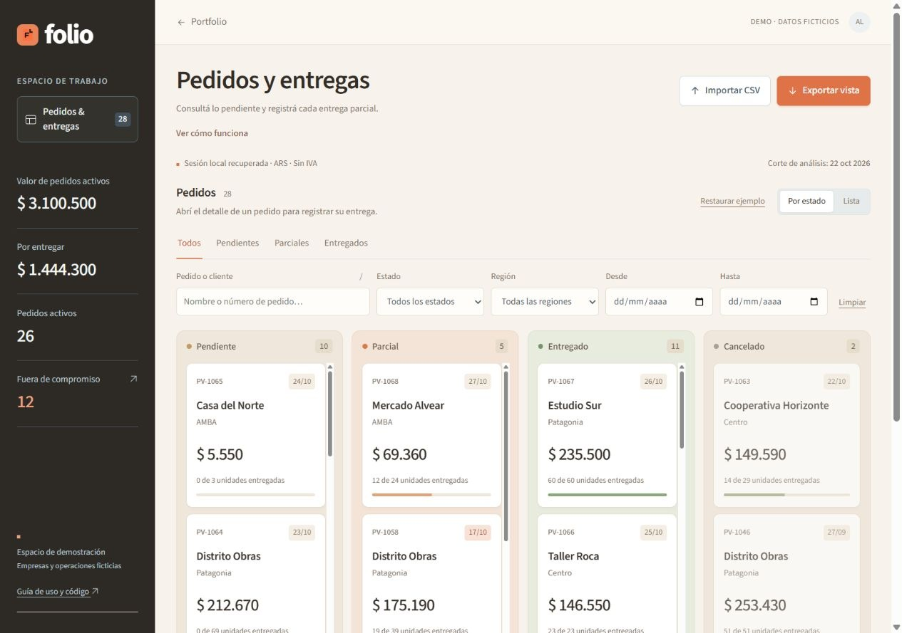

# Folio

Seguimiento de pedidos y entregas parciales. Cargás un CSV, buscás un pedido, registrás lo entregado y exportás la selección.

[Abrir la aplicación](https://enriqueariellopez.github.io/folio-orders/)



## Uso

La demo incluye 28 pedidos ficticios. La barra lateral resume los pedidos seleccionados; el tablero los agrupa por estado, con columnas de color y fechas vencidas destacadas. También podés cambiar a una lista y combinar filtros por cliente, región, fecha o estado. La tecla `/` lleva a la búsqueda.

Al abrir un pedido, indicá la **cantidad acumulada entregada** de cada material. Si había 12 unidades entregadas y hoy entregaste 6 más, registrá 18. No se admiten sobreentregas. Podés cancelar un pedido y volver a activarlo.

**Exportar vista** descarga todos los pedidos filtrados, incluidas las páginas que no están visibles. **Restaurar ejemplo** reemplaza la sesión actual. La guía **Ver cómo funciona** usa un pedido separado y no modifica tus datos.

Los importes se expresan en ARS, sin IVA. Son valores de pedidos, no facturación ni cobros. El corte del ejemplo es el 22/10/2026. Los cancelados no suman en los indicadores; el avance se pondera por importe.

## Archivo de entrada

[Descargar plantilla CSV](examples/pedidos.csv). Separador coma o punto y coma; UTF-8, comillas y campos multilínea admitidos.

| Columna | Contenido |
| --- | --- |
| `pedido` | Identificador del pedido |
| `cliente` | Nombre del cliente |
| `region` | Región o zona |
| `fecha` | Alta en formato `AAAA-MM-DD` |
| `compromiso` | Entrega prometida, mismo formato |
| `material` | Código del material |
| `descripcion` | Nombre del material |
| `cantidad` | Unidades solicitadas; entero de 1 a 100.000 |
| `precio_unitario` | Precio con punto decimal y sin miles, hasta dos decimales |
| `entregado` | Unidades acumuladas entregadas |
| `cancelado` | Opcional: `1` cancelado, `0` activo |

Los datos generales deben coincidir en todas las filas del mismo pedido. Límite: 2 MB y 5.000 filas, fechas entre 2000 y 2100 y hasta un año entre la primera y la última alta. Una importación inválida no reemplaza la sesión.

## Datos y límites

El archivo se procesa en el navegador. Folio guarda la sesión en el almacenamiento local de ese perfil; puede quedar disponible para quien use el mismo perfil. No se envía a un servidor ni se comparte entre equipos. Exportá lo que quieras conservar antes de borrar los datos del navegador.

Es una demo sin usuarios, permisos, colaboración ni conexión con SAP. Las empresas y operaciones incluidas son ficticias. El video narrado del final muestra una versión anterior de la interfaz.

## Ejecutar localmente

Python 3.10+ y un navegador actual:

```sh
python -m http.server 4181 --bind 127.0.0.1
```

Abrí `http://127.0.0.1:4181`. No requiere instalar paquetes ni compilar. Los módulos necesitan HTTP; no alcanza con abrir el HTML como archivo.

## Código y pruebas

HTML, CSS y módulos JavaScript. Source Sans 3 para la interfaz y la marca; fuentes y licencias SIL OFL en `assets/`.

| Ruta | Función |
| --- | --- |
| `src/domain.js` | Reglas de pedidos, entregas, estados e importes |
| `src/csv.js` | Lectura y escritura de archivos |
| `src/order-board.js` | Tablero y cambio de vista |
| `src/app.js` | Filtros, ficha y sesión local |
| `src/tutorial.js` | Guía con datos independientes |
| `style.css`, `interface.css` | Base y presentación de la aplicación |
| `sql/`, `scripts/analyze_sql.py` | Comprobación independiente con SQLite |
| `tests/` | Reglas, CSV y comparación JavaScript/SQLite |

Con Node 22+ y Python 3.10+, sin `npm install`:

```sh
npm test
python scripts/analyze_sql.py examples/pedidos.csv
```

`LOTE_PYTHON` permite indicar otro ejecutable de Python al runner de pruebas. Los importes se calculan en centavos enteros; los totales por pedido y lote activo no pueden superar `2^53 - 1` centavos. SQLite es una comprobación aparte, no el backend de la web. El analizador termina con código 2 si el archivo es inválido.

La exportación protege posibles prefijos de fórmulas y conserva los límites de cada celda. Las pruebas verifican el CSV generado, no el comportamiento de todas las planillas. La página incluye una CSP parcial para bases, objetos, formularios y scripts en atributos.

GitHub Pages publica `main`. Los cambios se revisan en una rama y pasan pruebas locales y CI antes del merge. El workflow vigente usa Node 20; su migración requiere un permiso de GitHub que no tiene la credencial de esta sesión.
